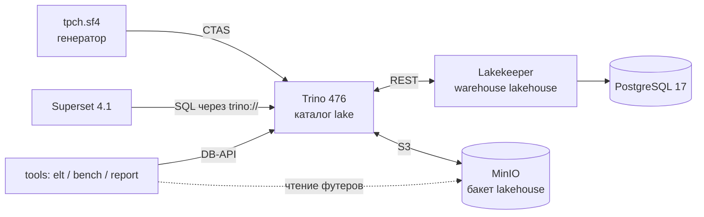
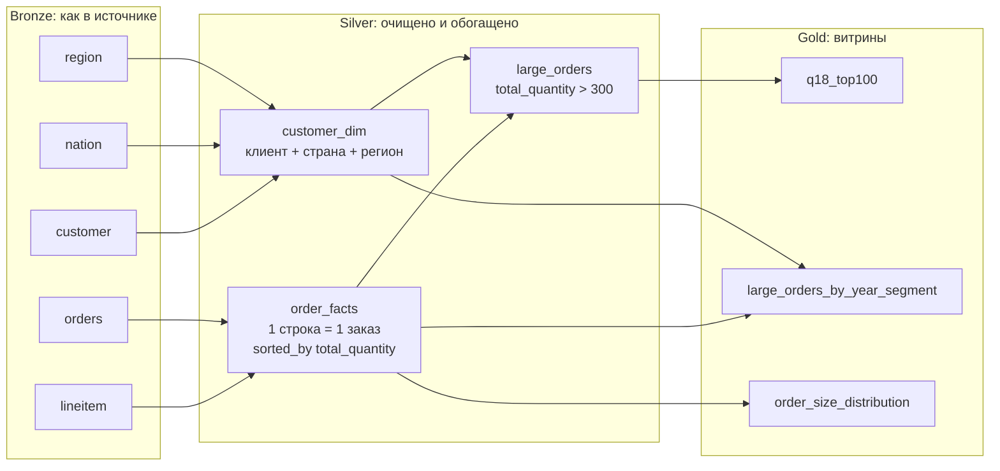
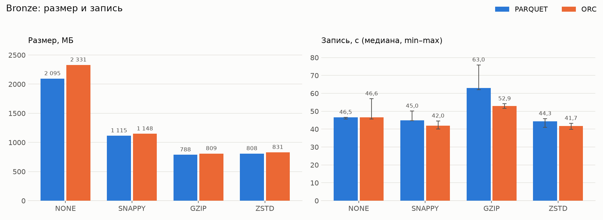
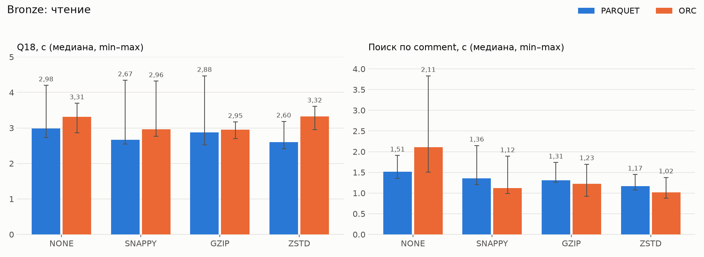

# Lakehouse на MinIO + Iceberg + Trino: ELT и бенчмарк хранения для TPC-H Q18

Практическая работа №1, вариант 3, запрос Q18 "Large Volume Customer"

Все цифры в отчете получены одним прогоном стенда 12.10.2026. У каждой таблицы указан файл из папки [`results/`](results), откуда она взята. Сырые замеры лежат там же в csv.

## Содержание
1. [Вариант и масштаб](#1-вариант-и-масштаб)
2. [Сервисы стенда](#2-сервисы-стенда)
3. [Какие данные нужны запросу](#3-какие-данные-нужны-запросу)
4. [Медальон: Bronze, Silver, Gold](#4-медальон-bronze-silver-gold)
5. [Бенчмарк форматов и кодеков](#5-бенчмарк-форматов-и-кодеков)
6. [Часть 2: Iceberg и BI](#6-часть-2-iceberg-и-bi)
7. [Выводы](#7-выводы)

## 1. Вариант и масштаб

| Поле | Значение |
|---|---|
| ФИО  | Петренко Вячеслав Георгиевич |
| Вариант (запрос) | Q18 "Large Volume Customer" |
| Масштаб `sfN` | sf4 |
| Почему такой масштаб | Q18 берет заказы, где суммарное количество товара больше 300, и оставляет 100 самых дорогих. На sf1 таких заказов всего 57, то есть `LIMIT 100` ничего не отрезает и проверять нечего. На sf4 их уже 249 ([`results/validation.md`](results/validation.md)), и топ-100 действительно что-то отбирает. Кроме того, на sf4 запросу есть над чем поработать: он группирует 23 996 604 строки `lineitem` в 6 000 000 заказов и идет 2,6-3,3 с. Больший масштаб на ноутбук не влез бы. На sf4 бакет со всеми слоями и восемью вариантами Bronze занял 10,9 ГБ, диск Docker за прогон вырос на 11,0 ГБ, один запрос занимал до 1,37 ГБ памяти при 7,5 ГБ у Docker. Для sf10 нужно примерно в 2,5 раза больше. Минус sf4 в том, что по времени Q18 кодеки все равно отличаются меньше, чем разброс замеров (раздел 5.3). Зато хорошо видна разница в размере, времени записи, объеме чтения и времени поиска по тексту. |

## 2. Сервисы стенда

Стенд описан в [`docker-compose.yml`](docker-compose.yml), версии образов заданы в [`.env`](.env).

| Сервис (контейнер) | Образ | Роль | Почему он |
|---|---|---|---|
| MinIO (`lh-minio`) | `bitnamilegacy/minio:2025.4.22` | S3-хранилище, бакет `lakehouse`. В нем лежат parquet/orc-файлы и метаданные Iceberg | Работает по S3 API, поэтому Trino и Superset обращаются к нему так же, как к облачному S3. Данные хранятся отдельно от вычислений: если перезапустить или заменить Trino, они никуда не денутся. Официальный образ `minio/minio` сейчас не скачивается, поэтому я взял сборку Bitnami с той же версией сервера (RELEASE.2025-04-22). |
| PostgreSQL (`lh-catalog-db`) | `postgres:17.5` | База каталога Lakekeeper | Lakekeeper хранит состояние каталога в PostgreSQL. При коммите Iceberg меняется указатель на metadata.json. Это делается в транзакции, поэтому два писателя не затрут снапшоты друг друга. |
| Lakekeeper (`lh-catalog`) | `quay.io/lakekeeper/catalog:v0.9.0` | Iceberg REST Catalog, warehouse `lakehouse` | Работает по открытому REST-протоколу Iceberg. К нему по одному URL могут подключиться Trino, Spark, PyIceberg, DuckDB. Hive Metastore требует Hadoop и Thrift. Nessie нужен для веток данных, а здесь они не используются. |
| Trino (`lh-trino`) | `trinodb/trino:476` | SQL-движок: ELT, бенчмарк, операции с Iceberg | Читает Iceberg прямо из S3. Умеет `CREATE TABLE AS` с выбором формата, кодека, партиций и сортировки, `MERGE`, time travel, метатаблицы `$files` и `$snapshots`. Встроенный коннектор `tpch` генерирует исходные данные нужного масштаба, скачивать ничего не надо. |
| Superset (`lh-superset`) | `apache/superset:4.1.2` + драйвер `trino` | BI: SQL Lab по Bronze, дашборд по Gold | См. раздел 6.2. |
| tools (`lh-tools`) | `python:3.12-slim` + `trino`, `pyarrow`, `matplotlib`, `requests` | Скрипты ELT, бенчмарка, демо и отчета | Время запросов берется из статистики сервера Trino. pyarrow открывает сами файлы в MinIO и читает их футеры (кодек, row group). |



### Скрипты развертывания

```bash
docker compose up -d                          # MinIO, PostgreSQL, Lakekeeper (+ migrate, bootstrap, warehouse), Trino
docker compose build tools                    # контейнер со скриптами
docker compose --profile bi up -d --build superset
```

| Контейнер | Что делает |
|---|---|
| `lh-minio` | сервер MinIO, том `s3-data`, порты 9000 (S3) и 9001 (консоль), бакет `lakehouse` |
| `lh-minio-init` | `mc mb --ignore-existing lh/lakehouse`, создает бакет и завершается |
| `lh-catalog-db` | PostgreSQL, том `catalog-db` |
| `lh-catalog-migrate` | `lakekeeper migrate`, создает схему базы каталога |
| `lh-catalog` | `lakekeeper serve`, порт 8181 |
| `lh-catalog-init` | `POST /management/v1/bootstrap`, `POST /management/v1/warehouse` с [`conf/lakekeeper/warehouse.json`](conf/lakekeeper/warehouse.json) |
| `lh-trino` | Trino, порт 8080, каталоги из [`conf/trino/catalog/`](conf/trino/catalog), лимит памяти запроса 3 ГБ ([`conf/trino/config.properties`](conf/trino/config.properties)) |
| `lh-superset` | Superset, порт 8088. При старте создает админа и подключение `Lakehouse (Trino)` |

Каталог Trino [`conf/trino/catalog/lake.properties`](conf/trino/catalog/lake.properties):

```properties
connector.name=iceberg
iceberg.catalog.type=rest
iceberg.rest-catalog.uri=http://catalog:8181/catalog
iceberg.rest-catalog.warehouse=lakehouse
iceberg.file-format=PARQUET
iceberg.compression-codec=ZSTD
fs.native-s3.enabled=true
s3.endpoint=http://object-store:9000
s3.path-style-access=true
```

Состояние контейнеров после прогона ([`results/docker_ps.txt`](results/docker_ps.txt), `docker compose --profile bi ps -a`):

```text
NAME                 IMAGE                               STATUS
lh-catalog           quay.io/lakekeeper/catalog:v0.9.0   Up 3 hours (healthy)
lh-catalog-db        postgres:17.5                       Up 3 hours (healthy)
lh-catalog-init      curlimages/curl:8.11.1              Exited (0) 2 minutes ago
lh-catalog-migrate   quay.io/lakekeeper/catalog:v0.9.0   Exited (0) 2 minutes ago
lh-minio             bitnamilegacy/minio:2025.4.22       Up 3 hours
lh-minio-init        bitnamilegacy/minio:2025.4.22       Exited (0) 2 minutes ago
lh-superset          lh-q18-superset:4.1.2               Up 5 minutes (healthy)
lh-trino             trinodb/trino:476                   Up 3 hours (healthy)
```

Пять сервисов работают. У Trino, Lakekeeper, PostgreSQL и Superset пройден healthcheck. У MinIO он в compose не задан, поэтому там просто `Up`. Три init-контейнера завершились с кодом 0. `lh-minio-init` создал бакет (`Bucket created successfully lh/lakehouse`), `lh-catalog-migrate` развернул схему каталога (`Database migration complete`), `lh-catalog-init` получил `bootstrap: HTTP 204` и `warehouse: HTTP 201`. Init-контейнеры запускаются заново при каждом `docker compose run tools`, поэтому время завершения у них свежее, чем у сервисов.


Весь прогон запускается скриптом `./run_all.sh`. Он по очереди поднимает стек, выполняет ELT и демо Iceberg, запускает бенчмарк, настраивает Superset и собирает сводку.

## 3. Какие данные нужны запросу

Q18 ищет "оптовые" заказы, то есть такие, где суммарное количество товара по всем позициям больше 300. Из них берутся 100 самых дорогих, и к каждому добавляется клиент.

| Таблица | Колонки | Что с ними делает Q18 |
|---|---|---|
| `lineitem` | `orderkey`, `quantity` | агрегат `sum(quantity)` по `orderkey` считается дважды: в подзапросе (`HAVING > 300`) и во внешнем запросе. Джойн с `orders` |
| `orders` | `orderkey`, `custkey`, `orderdate`, `totalprice` | фильтр `orderkey IN (подзапрос)`, джойн, сортировка по `totalprice DESC, orderdate`, вывод |
| `customer` | `custkey`, `name` | джойн по `custkey`, вывод имени |

У Q18 нет фильтра по датам или справочникам, поэтому `lineitem` приходится читать целиком. При этом из 16 колонок нужны только две узкие числовые. В Parquet + ZSTD они занимают 33 МБ из 623 МБ таблицы (раздел 5.3). Поэтому я взял колоночный формат и вынес `sum(quantity)` по заказу в Silver, чтобы не пересчитывать 24 млн строк при каждом запросе.

## 4. Медальон: Bronze, Silver, Gold



SQL слоев лежит в [`etl/sql/10_bronze.sql`](etl/sql/10_bronze.sql), [`20_silver.sql`](etl/sql/20_silver.sql) и [`30_gold.sql`](etl/sql/30_gold.sql). Запускает его [`tools/elt.py`](tools/elt.py). Этот же скрипт собирает [`results/layers.csv`](results/layers.csv), время шагов и проверки качества. Строки считаются через `count(*)`, вес берется как сумма `file_size_in_bytes` из `$files`, кодек читается из футера самого большого файла.

Что одинаково во всех слоях:
- Везде Iceberg, Parquet и ZSTD. Parquet взят потому, что Q18 читает 2 колонки из 16. ZSTD выбран по бенчмарку (раздел 5). С ним Bronze в 2,59 раза меньше несжатого Parquet (808 против 2 095 МБ) и только на 2,6 % больше, чем с GZIP. При этом запись идет 44,3 с вместо 63,0 с, и поиск по тексту быстрее, чем с GZIP, во всех пяти раундах.
- Партиций нет нигде. У Q18 нет фильтра, по которому их можно отсечь, он читает все годы и все заказы. Партиции по дате только разбили бы данные на мелкие файлы. Для фильтра `total_quantity > 300` я использую сортировку (раздел 4.2).

### 4.1. Bronze

В Bronze лежит копия источника без изменений плюс две технические колонки: `_batch_id` (идентификатор загрузки) и `_ingested_at` (время загрузки). По ним видно, какой загрузкой пришла строка. Silver при дедупликации берет самую свежую версию.

| Таблица | Колонки | Строк | Вес, МБ | Формат | Сжатие | Партиционирование | Обоснование |
|---|---|---:|---:|---|---|---|---|
| `lake.bronze.region` | все 3 + 2 тех. | 5 | 0,001 | PARQUET | ZSTD | нет | Справочник, нужен чтобы добавить клиенту регион. |
| `lake.bronze.nation` | все 4 + 2 тех. | 25 | 0,002 | PARQUET | ZSTD | нет | Справочник стран, 25 строк в одном файле. |
| `lake.bronze.customer` | все 8 + 2 тех. | 600 000 | 32,65 | PARQUET | ZSTD | нет | Читается целиком при джойне, фильтра по ней нет. |
| `lake.bronze.orders` | все 9 + 2 тех. | 6 000 000 | 152,53 | PARQUET | ZSTD | нет | Q18 фильтрует по `orderkey IN (...)`. Это не диапазон, партиции тут не помогут. |
| `lake.bronze.lineitem` | все 16 + 2 тех. | 23 996 604 | 623,40 | PARQUET | ZSTD | нет | Самая большая таблица. Q18 читает из нее 2 колонки, поэтому формат колоночный. Лишние колонки не убираю, потому что Bronze должен подходить и для других запросов. |

Весь Bronze занимает 808,58 МБ в 25 файлах данных (`customer` 2, `orders` 9, `lineitem` 12, справочники по одному). В футере самого большого файла каждой таблицы стоит кодек `ZSTD` ([`results/layers.csv`](results/layers.csv)). `lineitem` загружался 36,1 с, `orders` 10,0 с, `customer` 13,3 с ([`results/elt_steps.csv`](results/elt_steps.csv)).


### 4.2. Silver

| Шаг | Реализация |
|---|---|
| Очистка | убираются NULL в ключах и датах, `quantity <= 0`, `extendedprice <= 0`, `discount` и `tax` вне [0;1], позиции без заказа и заказы без позиций (INNER JOIN), дубли клиентов (`row_number() ... = 1`) |
| Нормализация | деньги и количество переводятся из `DOUBLE` в `DECIMAL`, чтобы суммы считались точно. Коды приводятся через `upper(trim())` |
| Обогащение | клиенту добавляются страна и регион. По заказу считаются `line_count`, `total_quantity`, `gross_amount`, `charged_amount`, `returned_lines`. Флаг `price_consistent` сверяет `orders.totalprice` с суммой позиций по формуле TPC-H `sum(extendedprice * (1 - discount) * (1 + tax))` с допуском 0,021 на позицию (откуда взят допуск, написано ниже) |

| Таблица | Колонки | Строк | Вес, МБ | Формат | Сжатие | Партиционирование | Обоснование |
|---|---|---:|---:|---|---|---|---|
| `lake.silver.customer_dim` | `custkey, customer_name, address, phone, acctbal, mktsegment, nation_name, region_name` | 600 000 | 22,77 | PARQUET | ZSTD | нет | Клиент сразу со страной и регионом, витринам не нужны джойны со справочниками. |
| `lake.silver.order_facts` | `orderkey, custkey, orderdate, order_year, orderstatus, orderpriority, totalprice, line_count, total_quantity, gross_amount, charged_amount, price_consistent, returned_lines, last_receiptdate` | 6 000 000 | 137,10 | PARQUET | ZSTD | нет. Вместо этого `sorted_by = total_quantity`, row group 8 МБ | Самая важная таблица в работе. `sum(quantity)` по 24 млн позиций считается один раз при загрузке, и Q18 читает 6 млн готовых строк. Из-за сортировки по `total_quantity` и небольших row group у каждого row group получается узкий диапазон min/max. По фильтру `> 300` Trino пропускает все row group, кроме последнего в каждом файле. Читаются 6 row group из 33, это 738 263 строки из 6 000 000 ([`results/order_facts_rowgroups.csv`](results/order_facts_rowgroups.csv)). |
| `lake.silver.large_orders` | `orderkey, custkey, customer_name, mktsegment, nation_name, region_name, orderdate, order_year, totalprice, total_quantity, line_count` | 249 | 0,007 | PARQUET | ZSTD | нет | Подзапрос Q18, сохраненный как таблица: крупные заказы вместе с клиентом. 249 строк в файле 7,1 КБ. |

На диске `order_facts` устроена так. Trino писал таблицу шестью параллельными писателями, поэтому получилось шесть файлов, и каждый отсортирован по `total_quantity` сам по себе. В самом большом файле 2 607 241 строка (59,6 МБ) и 14 row group:

| Row group | Строк | min `total_quantity` | max `total_quantity` |
|---:|---:|---:|---:|
| 0 | 242 558 | 1 | 26 |
| 1 | 186 576 | 26 | 39 |
| 2 | 186 586 | 39 | 50 |
| ... | ... | ... | ... |
| 12 | 186 602 | 177 | 204 |
| 13 | 125 628 | 204 | 327 |

Порог 300 попадает только в последний row group. Так в каждом из шести файлов. В самом маленьком файле (67 246 строк) row group всего один, он покрывает весь диапазон от 1 до 327. Таблица строилась 36,7 с, пик памяти 1 366 МБ, прочитано 29 996 604 строки (`lineitem` и `orders` целиком). `customer_dim` построился за 7,6 с, `large_orders` за 1,2 с.


Проверки качества ([`results/dq_checks.csv`](results/dq_checks.csv)):

| Проверка | Значение |
|---|---:|
| `bronze.lineitem`: строк | 23 996 604 |
| `lineitem`: NULL в `orderkey` | 0 |
| `lineitem`: `quantity <= 0` | 0 |
| `lineitem`: `extendedprice <= 0` | 0 |
| `lineitem`: `discount` или `tax` вне [0; 1] | 0 |
| `lineitem`: позиции без заказа | 0 |
| `bronze.orders`: строк | 6 000 000 |
| `orders`: заказы без позиций | 0 |
| `silver.order_facts`: строк | 6 000 000 |
| `order_facts`: `totalprice` расходится с суммой позиций (флаг `price_consistent`) | 0 |
| `order_facts`: макс. отклонение `totalprice` от суммы позиций | 0,1148 |
| `order_facts`: то же в пересчете на одну позицию | 0,0205 |
| `orders`: `totalprice` не равен сумме позиций по арифметике генератора | 0 |
| `bronze.customer`: строк | 600 000 |
| `customer`: дубли `custkey` | 0 |
| `silver.customer_dim`: строк | 600 000 |
| `customer_dim`: клиенты без страны | 0 |
| `order_facts`: заказов с `total_quantity > 300` | 249 |
| `silver.large_orders`: строк | 249 |
| `order_facts`: максимум `total_quantity` | 328 |

Очистка ничего не отбросила, в Silver попали все 6 000 000 заказов и все 600 000 клиентов. Для данных из генератора TPC-H это нормально. Правила я оставил на случай настоящего источника с грязными данными.

Про сверку сумм. `totalprice` заказа не совпадает с точной суммой `extendedprice * (1 - discount) * (1 + tax)` по позициям. Отклонение доходит до 0,1148 на заказ и до 0,0205 на позицию, и `totalprice` всегда меньше. Дело в генераторе: он считает в целых копейках и на каждой позиции два раза отбрасывает дробную часть, после скидки и после налога. На этом теряется до 2,06 коп. на позицию. Я это проверил: если посчитать так же с усечением (`truncate(truncate(extendedprice * (1 - discount), 2) * (1 + tax), 2)`), сумма совпадает с `totalprice` у всех 6 000 000 заказов. Поэтому допуск для флага `price_consistent` равен 0,021 на позицию. Усечение генератора в него укладывается, а расхождение больше 2,1 коп. на позицию считается ошибкой.

### 4.3. Gold

| Таблица | Колонки | Строк | Вес, МБ | Формат | Сжатие | Партиционирование | Обоснование |
|---|---|---:|---:|---|---|---|---|
| `lake.gold.q18_top100` | `top_rank, customer_name, custkey, orderkey, orderdate, totalprice, total_quantity, mktsegment, nation_name` | 100 | 0,004 | PARQUET | ZSTD | нет | Ответ на Q18. `top_rank` хранит порядок строк. Страна и сегмент добавлены для фильтров в BI. |
| `lake.gold.large_orders_by_year_segment` | `order_year, mktsegment, region_name, all_orders, large_orders, large_customers, large_share_pct, large_orders_amount` | 175 | 0,003 | PARQUET | ZSTD | нет | Крупные заказы по годам и их доля от всех заказов. Нужна для дашборда. |
| `lake.gold.order_size_distribution` | `qty_from, qty_to, size_bucket, is_large, orders, share_pct` | 14 | 0,001 | PARQUET | ZSTD | нет | Распределение заказов по объему с шагом 25. Показывает, насколько порог 300 далек от обычного заказа. |

Что видно в витринах:
- В `large_orders_by_year_segment` 175 строк, это 7 лет на 5 сегментов на 5 регионов. Сумма `all_orders` по всем строкам равна 6 000 000, сумма `large_orders` равна 249. Значит, витрина сходится с Silver.
- Крупных заказов 249 из 6 000 000, это 0,0042 % (один на 24 тысячи). По годам их 44, 28, 39, 39, 37, 43 и 19. 1998 год неполный, заказы в данных заканчиваются 2 августа 1998 года. Самая большая доля в одной ячейке 0,0197 % (7 заказов из 35 588).
- В `order_size_distribution` 14 интервалов по 25 единиц. Выше порога два интервала: 246 заказов (301-325) и 3 заказа (326-350). Максимум по всем заказам 328.

Проверка корректности ([`results/validation.md`](results/validation.md)):
- Gold построчно сравнивается с Q18 из `варианты.md`, который выполнен напрямую по `tpch.sf4`, без Lakehouse. Сравнивались все 100 строк (`orderkey`, `custkey`, `totalprice`, количество), расхождений нет.
- Q18 по `tpch.sf1` сравнивается с эталоном из спецификации TPC-H. Там 57 строк, первая: `Customer#000128120`, заказ `4722021` от 1994-04-07, 544 089,09, количество 323. Trino вернул 57 строк, первая строка такая же.

Первые строки витрины ([`results/gold_q18_top100.csv`](results/gold_q18_top100.csv)):

| # | Клиент | `orderkey` | Дата | `totalprice` | Количество |
|---:|---|---:|---|---:|---:|
| 1 | Customer#000328669 | 22897223 | 1998-01-24 | 564 350,60 | 309 |
| 2 | Customer#000066835 | 17366275 | 1998-01-14 | 539 704,09 | 316 |
| 3 | Customer#000538331 | 18449123 | 1993-09-30 | 537 736,85 | 313 |
| ... | | | | | |
| 100 | Customer#000122995 | 12251526 | 1993-12-24 | 464 867,56 | 305 |


## 5. Бенчмарк форматов и кодеков

### 5.1. Методика

[`tools/bench.py`](tools/bench.py) пересоздает три таблицы Bronze, которые читает Q18 (`customer`, `orders`, `lineitem`), в 8 вариантах: форматы PARQUET и ORC, кодеки NONE, SNAPPY, GZIP и ZSTD. Каждый вариант пишется в свою схему `lake.bm_<формат>_<кодек>`.

| Метрика | Как измеряется |
|---|---|
| Время записи | `CREATE TABLE ... WITH (format = ...) AS SELECT * FROM tpch.sf4.<t>`, кодек задается сессионным свойством `lake.compression_codec`. На каждый вариант 3 записи, берется медиана суммы по таблицам. Время серверное (`elapsedTimeMillis`). |
| Стоимость генерации | те же таблицы читаются из `tpch` без записи (`checksum` по всем колонкам). Это время вычитается, чтобы оценить, сколько уходит на сжатие и запись. Оценка получается снизу, потому что `checksum` тоже тратит CPU, а при записи его нет |
| Размер | `sum(file_size_in_bytes)` из `$files` |
| Проверка кодека | футер самого большого файла каждой таблицы читается из MinIO через pyarrow |
| Скорость агрегаций | Q18 (полный проход по 2 узким колонкам `lineitem` и 2 джойна) и TEXT_SCAN, то есть `count/sum ... WHERE comment LIKE '%carefully%' GROUP BY shipmode`. Второй запрос читает самую тяжелую текстовую колонку, на ней распаковка заметнее всего. Сначала прогрев, потом 5 раундов. В каждом раунде варианты идут в случайном порядке. |
| Очистка между записями | каждый вариант пишется отдельным запуском ([`run_bench.sh`](run_bench.sh)). После каждой перезаписи скрипт ждет, пока объем бакета перестанет уменьшаться (файлы удаляются не сразу), и в Docker Desktop делает `fstrim`. Без этого виртуальный диск разрастается из-за удаленных файлов и следующие записи идут медленнее. Журнал лежит в `results/bench/storage_log.csv`. |

Окружение ([`results/environment.md`](results/environment.md), `docker version`, `docker info`):

| Параметр | Значение |
|---|---|
| Хост | ноутбук, AMD Ryzen 5 5600H (12 логических процессоров), 15,4 ГБ RAM, Windows 10 Pro (сборка 19045) |
| Docker | Docker Desktop 4.89.0, Engine 29.7.2, Compose v5.5.0, WSL2 (ядро 6.18.40.1) |
| Docker VM | 12 CPU, 7,5 ГБ RAM, 2 ГБ swap |
| Trino | 476, один узел (координатор и воркер), OpenJDK 24.0.1, `query.max-memory-per-node=3GB` |
| Масштаб | sf4 |
| Хранилище | MinIO в той же Docker VM |

Больше всего памяти занял запрос построения `order_facts`, 1 366 МБ. При записи вариантов было до 1 338 МБ, у Q18 не больше 710 МБ. Лимит 3 ГБ оказался с запасом, на sf4 хватило бы значения по умолчанию.

Как прошел прогон и что пошло не по плану:

- Бенчмарк прошел за один запуск `./run_bench.sh`, 35 минут, без сбоев и повторов. В отчет вошли все 3 записи каждого варианта и все 5 раундов чтения, ни один замер я не выбрасывал.
- Очистка хранилища между записями работала. Во всех 24 точках контроля объем бакета уже не менялся, и ожидание занимало минимальные 20 с ([`results/bench/storage_log.csv`](results/bench/storage_log.csv)). Диск Docker за бенчмарк вырос на 11,0 ГБ, новых данных в бакете при этом 10,1 ГБ. Значит, удаленные файлы диск не раздували.
- Перед основным прогоном я проверил SQL слоев на `tpch.tiny`. Оказалось, что флаг `price_consistent` с первым вариантом допуска помечал как ошибочные 3 % нормальных заказов (498 из 15 000). Допуск я исправил до основного ELT, объяснение есть в разделе 4.2.
- После бенчмарка пришлось пересобрать Gold. В двух витринах доля считалась с точностью 0,1 % и для крупных заказов округлялась до нуля. Bronze и Silver не менялись. Сверку `q18_top100` с прямым Q18 я повторил, она снова сошлась. Замер "Gold" в таблице слоев сделан до пересборки, но содержимое `q18_top100` от нее не зависит.
- Диапазоны `total_quantity` по row group получены чтением самой колонки. pyarrow не показывает статистику DECIMAL-колонок в файлах Trino, хотя в футере она есть: Trino пишет только поля `min_value` и `max_value` (я проверил по байтам футера). То, что Trino этой статистикой пользуется, видно по `EXPLAIN ANALYZE` ([`results/order_facts_pruning_explain.txt`](results/order_facts_pruning_explain.txt)).
- Образ `tools` собрался не с первого раза, обрывалась сеть при скачивании пакетов. На замеры это не влияет, они все сделаны уже после сборки.

### 5.2. Результаты

На каждый вариант 3 записи и 5 замеров чтения после прогрева. Время указано как медиана, в скобках минимум и максимум. Размер считается по трем таблицам Bronze (`customer`, `orders`, `lineitem`). Жирным выделена лучшая медиана в столбце. Насколько этой разнице можно верить, разобрано в 5.3. Таблица взята из [`results/report.md`](results/report.md), сырые замеры лежат в `results/bench/*.csv`.

| Вариант | Кодек в файле | Bronze, МБ | lineitem, МБ | Сжатие vs NONE | Запись, с | Запись минус генерация, с | Q18, с | Q18 прочитано, МБ | TEXT_SCAN, с | TEXT_SCAN прочитано, МБ |
|---|---:|---:|---:|---:|---:|---:|---:|---:|---:|---:|
| PARQUET + NONE | UNCOMPRESSED | 2 095,1 | 1 515,4 | 1,00x | 46,5 (45,7-46,6) | 18,6 | 2,98 (2,73-4,20) | 533,8 | 1,51 (1,36-1,91) | 759,8 |
| PARQUET + SNAPPY | SNAPPY | 1 115,2 | 837,1 | 1,88x | 45,0 (44,8-50,1) | 17,0 | 2,67 (2,55-4,34) | 230,0 | 1,36 (1,21-2,15) | 333,1 |
| PARQUET + GZIP | GZIP | **788,0** | 609,0 | 2,66x | 63,0 (62,1-75,9) | 35,0 | 2,88 (2,53-4,47) | 139,8 | 1,31 (1,26-1,74) | 219,6 |
| PARQUET + ZSTD | ZSTD | 808,4 | 623,3 | 2,59x | 44,3 (41,1-45,8) | 16,4 | **2,60 (2,41-3,18)** | 129,0 | 1,17 (1,07-1,45) | 233,3 |
| ORC + NONE | UNCOMPRESSED | 2 330,7 | 1 838,3 | 1,00x | 46,6 (45,7-57,0) | 18,7 | 3,31 (2,86-3,70) | 554,7 | 2,11 (1,51-3,83) | 899,5 |
| ORC + SNAPPY | SNAPPY | 1 148,0 | 911,2 | 2,03x | 42,0 (40,1-44,6) | 14,0 | 2,96 (2,76-4,32) | 249,3 | 1,12 (0,99-1,89) | 342,0 |
| ORC + GZIP | ZLIB | 808,8 | 641,4 | 2,88x | 52,9 (51,7-54,2) | 24,9 | 2,95 (2,70-3,17) | 169,6 | 1,23 (0,92-1,70) | 223,5 |
| ORC + ZSTD | ZSTD | 830,6 | 660,8 | 2,81x | **41,7 (40,0-43,2)** | 13,7 | 3,32 (2,95-3,61) | 175,9 | **1,02 (0,88-1,38)** | 231,5 |

Генерация тех же трех таблиц коннектором `tpch` без записи занимает 27,9 с (медиана трех повторов: 30,2 / 27,9 / 26,3 с).

Первый запуск после записи и процессорное время:

| Вариант | Q18 первый запуск, с | Q18 CPU, с | TEXT_SCAN первый запуск, с | TEXT_SCAN CPU, с | Запись CPU, с |
|---|---:|---:|---:|---:|---:|
| PARQUET + NONE | 5,74 | 15,3 | 1,86 | 5,7 | 230 |
| PARQUET + SNAPPY | 3,04 | 15,5 | 1,26 | 6,6 | 238 |
| PARQUET + GZIP | 2,62 | 16,1 | 1,32 | 7,5 | 358 |
| PARQUET + ZSTD | 2,60 | 15,3 | 1,06 | 6,2 | 242 |
| ORC + NONE | 3,73 | 17,9 | 1,74 | 5,3 | 233 |
| ORC + SNAPPY | 3,50 | 18,0 | 1,04 | 5,9 | 231 |
| ORC + GZIP | 2,96 | 18,1 | 1,23 | 6,7 | 298 |
| ORC + ZSTD | 3,07 | 18,5 | 1,13 | 5,4 | 244 |

Кодеки я проверил по самим файлам. Во всех 8 вариантах и во всех трех таблицах кодек в футере файла совпал с тем, который задавался (`results/bench/*_sizes.csv`, колонка `codec_in_file`). Два названия пишутся иначе: `NONE` в файле называется `UNCOMPRESSED`, а `GZIP` в ORC называется `ZLIB`. Число строк во всех вариантах одинаковое: 600 000 / 6 000 000 / 23 996 604.






Сводка в формате шаблона (Parquet):

| Сжатие на Bronze | Время запроса | Размер Bronze, МБ | Вывод |
|---|---|---|---|
| GZIP | 2,88 с (2,53-4,47) | 788,0 | Самый маленький размер, на 20,4 МБ (2,5 %) меньше ZSTD. Но запись идет 63,0 с против 44,3 с (на 42 % дольше) и тратит 358 с CPU против 242 с. При чтении выигрыша нет. |
| ZSTD | 2,60 с (2,41-3,18) | 808,4 | Выбрал его. Размер почти такой же, запись заметно быстрее. По Q18 интервалы пересекаются, так что формально кодеки равны, хотя ZSTD был быстрее в 4 раундах из 5. В поиске по тексту ZSTD быстрее GZIP во всех 5 раундах (1,17 против 1,31 с), потому что распаковка GZIP требует на 22 % больше CPU. |

Дальше сравнение слоев и сортировки в Silver. Q18 выполнялся по разным слоям, 5 раундов после прогрева, источники в каждом раунде шли в случайном порядке ([`results/bench/layout.csv`](results/bench/layout.csv)):

| Источник | Файлов | Время, с | CPU, с | Прочитано, МБ | Строк обработано |
|---|---:|---:|---:|---:|---:|
| Bronze: исходный Q18 | 12 (`lineitem`) | 2,51 (2,25-3,99) | 16,1 | 133,0 | 55 193 457 |
| Silver `order_facts` без сортировки | 6 | 0,37 (0,33-1,31) | 1,08 | 78,6 | 7 200 000 |
| Silver `order_facts`, `sorted_by total_quantity` | 6 | 0,23 (0,18-0,53) | 0,28 | 13,3 | 1 938 263 |
| Gold `q18_top100` | 1 | 0,04 (0,03-0,08) | 0,003 | 0,004 | 100 |

Row group с `max(total_quantity) > 300`, то есть те, которые фильтр Q18 не может пропустить:

| Таблица | Файлов | Row group всего | Из них с max > 300 | Строк в них |
|---|---:|---:|---:|---:|
| `silver.order_facts` (`sorted_by`) | 6 | 33 | 6 | 738 263 |
| `order_facts` без сортировки | 6 | 35 | 35 | 6 000 000 |

Данные взяты из [`results/order_facts_rowgroups.csv`](results/order_facts_rowgroups.csv) и [`results/bench/unsorted_rowgroups.csv`](results/bench/unsorted_rowgroups.csv). `EXPLAIN ANALYZE` запроса `SELECT count(*) ... WHERE total_quantity > 300` показывает то же самое со стороны Trino: на вход пришло 738 263 строки для отсортированной таблицы и 6 000 000 для неотсортированной ([`results/order_facts_pruning_explain.txt`](results/order_facts_pruning_explain.txt)).

### 5.3. Анализ

#### Как я отличал разницу от шума

Размеры и объем чтения от прогона к прогону не меняются, а время скачет. В чтении первый и пятый раунды получились медленнее остальных сразу у всех вариантов (медиана Q18 по раундам: 3,12 / 2,86 / 2,87 / 2,84 / 3,44 с). Поэтому я считаю, что A быстрее B, только в двух случаях. Первый случай: интервалы от минимума до максимума не пересекаются. Второй: A быстрее B в каждом из пяти раундов. Внутри раунда все восемь вариантов измеряются подряд, так что условия у них одинаковые. Все остальное я считаю разницей в пределах разброса.

#### Размер

- Без сжатия три таблицы занимают 2 095 МБ в Parquet и 2 331 МБ в ORC. SNAPPY уменьшает объем в 1,88 и 2,03 раза, ZSTD в 2,59 и 2,81, GZIP в 2,66 и 2,88.
- Меньше всех PARQUET + GZIP, 788,0 МБ. PARQUET + ZSTD занимает 808,4 МБ, это на 20,4 МБ (2,6 %) больше. ORC с тем же кодеком больше Parquet на 2,6-2,9 %, без сжатия на 11 %.
- На каких колонках кодек дает эффект, видно по футерам Parquet-файлов `lineitem` (все файлы таблицы, 23 996 604 строки):

| Колонка `lineitem` | Кодирование Parquet | NONE, МБ | SNAPPY, МБ | GZIP, МБ | ZSTD, МБ | Выигрыш ZSTD |
|---|---|---:|---:|---:|---:|---:|
| `comment` | PLAIN (текст) | 731,9 | 305,4 | 192,2 | 205,6 | 3,6x |
| `extendedprice` | PLAIN (DOUBLE) | 192,0 | 138,1 | 97,7 | 102,5 | 1,9x |
| `partkey` | PLAIN | 192,0 | 117,9 | 80,4 | 78,5 | 2,4x |
| `orderkey` | словарь и PLAIN | 161,8 | 44,3 | 18,5 | 15,0 | 10,8x |
| `shipdate` | словарь, 12 бит на значение | 36,2 | 36,2 | 35,9 | 36,1 | 1,0x |
| `quantity` | словарь, 6 бит на значение | 18,1 | 18,1 | 17,9 | 18,1 | 1,0x |
| Вся таблица | | 1 515,4 | 837,1 | 609,0 | 623,3 | 2,4x |

Почти половину несжатого файла (48 %) занимает текст `comment`. Больше всего кодек сжимает его и колонки, записанные без словаря. `quantity` (50 разных значений) и даты Parquet сам упаковал словарем в 6 и 12 бит на значение, кодек там уже ничего не дает. На тексте GZIP сжимает лучше ZSTD (192 против 206 МБ), на ключах лучше ZSTD (`orderkey`: 15,0 против 18,5 МБ). SNAPPY сжимает хуже обоих, он рассчитан на скорость.

#### Запись

- Дороже всего пишется GZIP, в обоих форматах: 63,0 с в Parquet и 52,9 с в ORC. У остальных шести вариантов 41,7-46,6 с. По CPU так же: 358 и 298 с против 230-244 с. Интервал PARQUET + GZIP (62,1-75,9 с) не пересекается ни с одним другим вариантом. Он на 42 % медленнее PARQUET + ZSTD (44,3 с, 41,1-45,8).
- В ORC со сжатием запись идет быстрее, чем без него. ZSTD 41,7 с (40,0-43,2) и SNAPPY 42,0 с (40,1-44,6) против 46,6 с (45,7-57,0) без сжатия, интервалы не пересекаются. CPU почти одинаковый (244 и 231 с против 233 с), зато в MinIO уходит в 2-2,8 раза меньше байт.
- В Parquet картина похожая: 44,3 с (ZSTD) и 45,0 с (SNAPPY) против 46,5 с без сжатия. Но тут интервалы пересекаются, так что разница в пределах разброса.
- ZSTD и SNAPPY внутри одного формата по времени записи различить не удалось, интервалы пересекаются.
- Если сравнивать форматы, то с GZIP ORC пишется быстрее Parquet (52,9 против 63,0 с, интервалы не пересекаются). Со SNAPPY ORC тоже быстрее (42,0 против 45,0 с), но интервалы расходятся всего на 0,2 с. С ZSTD и без сжатия интервалы пересекаются.
- Если вычесть генерацию данных (27,9 с), на сжатие и запись остается 13,7-18,7 с у шести вариантов и 24,9-35,0 с у GZIP. Это оценка снизу (см. методику).

#### Чтение: Q18

- Медианы лежат между 2,60 и 3,32 с, интервалы всех восьми вариантов пересекаются. То есть по времени Q18 я не могу уверенно различить ни кодеки, ни форматы.
- Лучшая медиана у PARQUET + ZSTD: 2,60 с (2,41-3,18). В раундах он занимал места 3, 3, 1, 1, 2 из восьми, и ни один вариант не обогнал его больше чем в одном раунде. Это похоже на правду, потому что он читает меньше всех, но строго это не доказано.
- По объему чтения разница в разы: 533,8 МБ без сжатия, 230,0 МБ со SNAPPY, 139,8 МБ с GZIP и 129,0 МБ с ZSTD (Parquet).
- Больше всего помогает колоночный формат. Q18 проходит `lineitem` дважды (в подзапросе и во внешнем запросе), но берет только `orderkey` и `quantity`. В PARQUET + ZSTD это 33,0 МБ из 623,3 МБ таблицы. Если сложить по футерам 2 x 33,0 МБ, 59,5 МБ (четыре колонки `orders`) и 1,0 МБ (две колонки `customer`), получится 126,5 МБ. Это сходится с измеренными 129,0 МБ и составляет 16 % от 808 МБ Bronze.
- Разница в байтах в четыре раза не дает такой же разницы во времени, потому что Q18 упирается в процессор. Он тратит 15-18 с CPU при 2,6-3,3 с общего времени, это агрегация 24 млн строк в 6 млн групп на 12 потоках. MinIO стоит на той же машине, и лишние 400 МБ читаются за доли секунды. В удаленном объектном хранилище чтение, скорее всего, весило бы больше, но этого я не измерял.

#### Чтение: поиск по тексту (TEXT_SCAN)

Запрос читает `comment`, `shipmode` и `quantity`. Фильтр проходят 2 315 074 строки из 23 996 604.

- Здесь кодеки различаются. PARQUET + ZSTD (1,17 с) быстрее каждого из трех других Parquet-вариантов во всех пяти раундах. У GZIP 1,31 с, у SNAPPY 1,36 с, у NONE 1,51 с.
- Вариант без сжатия самый медленный, хотя CPU тратит меньше всех (5,7 с против 6,2 с у ZSTD). Ему нужно прочитать 760 МБ вместо 220-330 МБ. В ORC это еще заметнее: ORC + NONE был последним во всех пяти раундах (2,11 с, 1,51-3,83), читает он 900 МБ.
- GZIP читает меньше всех (219,6 МБ против 233,3 МБ у ZSTD), но по времени проигрывает. На распаковку у него уходит 7,5 с CPU (7,2-7,7) против 6,2 с (5,6-6,2), интервалы не пересекаются.
- Получается, что на тяжелой текстовой колонке сжатие ускоряет чтение, и лучше всего работает кодек с быстрой распаковкой, даже если сжимает он чуть хуже.

#### Parquet или ORC

- На Q18 ORC тратит больше процессора: 17,9-18,5 с против 15,3-16,1 с. Для ZSTD интервалы не пересекаются (17,5-18,9 против 15,1-15,6 с), разница 21 %. По времени PARQUET + ZSTD быстрее ORC + ZSTD во всех пяти раундах (2,60 против 3,32 с).
- ORC читает для Q18 больше данных: 175,9 МБ против 129,0 МБ с ZSTD. Дело в колонке `quantity`. Это DOUBLE с 50 разными значениями. Parquet кодирует ее словарем и тратит 18 МБ на 24 млн значений. ORC по спецификации хранит DOUBLE без кодирования, по 8 байт: 23 996 604 x 8 = 192 МБ до сжатия. И Q18 читает эту колонку дважды.
- В поиске по тексту ORC со сжатием не хуже Parquet. С ZSTD 1,02 против 1,17 с, ORC быстрее в 4 раундах из 5. По моему правилу это в пределах разброса.
- Q18 работает только с числовыми колонками, поэтому для него Parquet выгоднее. К тому же в Iceberg это формат по умолчанию.

#### Сортировка Silver и слои

- Сортировка уменьшает чтение. По фильтру `total_quantity > 300` Trino читает 6 row group из 33, то есть 738 263 строки вместо 6 000 000. С диска читается 13,3 МБ вместо 78,6 МБ (в 5,9 раза меньше), CPU 0,28 с вместо 1,08 с. В таблице без сортировки значения больше 300 есть во всех 35 row group, и пропустить ничего нельзя.
- По времени 0,23 с против 0,37 с по медиане, разница в 1,6 раза. Интервалы пересекаются, потому что время падало от раунда к раунду у всех источников (первый раунд шел сразу после записи таблицы). Но в каждом из пяти раундов отсортированная таблица быстрее: 0,53 / 0,25 / 0,23 / 0,20 / 0,18 с против 1,31 / 0,62 / 0,37 / 0,33 / 0,34 с.
- Эффект мог быть больше, его ограничивает число файлов. Таблицу писали шесть писателей, каждый файл отсортирован отдельно, и крупные заказы есть в конце каждого файла. Если бы файл был один, фильтру хватило бы одного row group примерно на 190 тыс. строк. Это моя оценка, я ее не измерял.
- Агрегат, посчитанный заранее в Silver, дает больше, чем сортировка. Даже без сортировки запрос к `order_facts` идет 0,37 с (0,33-1,31) против 2,51 с (2,25-3,99) у исходного Q18 по Bronze, интервалы не пересекаются. Обрабатывается 7,2 млн строк вместо 55,2 млн, CPU падает с 16,1 до 1,1 с. Причина в том, что `sum(quantity)` по 24 млн позиций посчитан один раз при загрузке.
- Gold отдает готовые 100 строк из файла 3,9 КБ за 0,04 с. Это в 63 раза быстрее Q18 по Bronze и почти в 6 раз быстрее отсортированного Silver.

#### Что выбрано

| Слой | Формат и кодек | Раскладка | Почему |
|---|---|---|---|
| Bronze | Parquet + ZSTD | без партиций и сортировки | В 2,59 раза меньше несжатого. GZIP меньше еще на 2,5 %, но пишется на 42 % дольше и медленнее читает текст. SNAPPY на 38 % больше ZSTD и по времени ничего не выигрывает. Parquet лучше ORC, потому что ORC тратит на Q18 на 21 % больше CPU. |
| Silver | Parquet + ZSTD | `order_facts`: `sorted_by total_quantity`, row group 8 МБ | Готовый агрегат сокращает Q18 с 2,51 до 0,37 с, сортировка еще до 0,23 с, а объем чтения уменьшает в 5,9 раза. Партиции не нужны, у Q18 нет фильтра по дате. |
| Gold | Parquet + ZSTD | без партиций | Таблицы весят килобайты, формат оставил тот же, чтобы везде было одинаково. Главное тут сама витрина, ответ за 0,04 с. |

#### Ограничения

Все измерено на одном ноутбуке с одним узлом Trino. MinIO работает на этой же машине, поэтому чтение и запись здесь быстрее, чем было бы с удаленным S3. Запросы идут 1-3 с, записей на вариант три, раундов чтения пять. При таких условиях уверенно видна только разница в десятки процентов.

## 6. Часть 2: Iceberg и BI

### 6.1. Понять и объяснить

Зачем нужны большие данные и lakehouse, если есть обычная БД? Q18 относится к обычным аналитическим запросам: надо пройти все 24 млн позиций, сгруппировать их по заказу и соединить с заказами и клиентами. Строковая OLTP-база вроде PostgreSQL для этого читает с диска все колонки всех строк. Расти она может только за счет более мощного сервера, а тяжелая аналитика мешает обычным транзакциям. Аналитические хранилища (Vertica, Greenplum, ClickHouse) считают быстро, но хранят данные в своем формате, и другим инструментом их можно прочитать только через выгрузку. В lakehouse три вещи разделены:
- данные лежат в дешевом объектном хранилище;
- формат открытый: колоночный Parquet и поверх него Iceberg, который добавляет транзакции, схему, снапшоты и статистику;
- считать может любой движок.

В этой работе Trino строит слои, а Superset по тем же таблицам строит отчеты. Чтобы поменять кодек или сортировку, достаточно одного `CREATE TABLE AS`, переезжать на другую систему не нужно.

Пример Schema Evolution на Silver (скрипт [`tools/iceberg_demo.py`](tools/iceberg_demo.py), протокол в [`results/iceberg_demo.md`](results/iceberg_demo.md)). На копии `silver.large_orders` я сделал три изменения:
- `ADD COLUMN size_class`, новый признак;
- `RENAME COLUMN total_quantity TO total_qty`;
- `ALTER COLUMN totalprice SET DATA TYPE DECIMAL(18,2)`, расширение типа, чтобы помещались большие суммы.

Файл данных до трех ALTER был 1 и после них остался 1. Данные не переписывались. Iceberg находит колонки по id поля, поэтому старые файлы читаются по новой схеме. Новая колонка в них равна `NULL`, переименованная отдает прежние значения (в протоколе это заказ `6882`: `total_qty` 303, `totalprice` 522 208,58, `size_class` NULL). Потом `UPDATE` заполнил `size_class`: `L` получили 233 заказа, `XL` (количество от 320) получили 16.


Пример Time Travel и восстановления. Сценарий такой:
1. сбой ETL обнулил `totalprice` у заказов начиная с 1995 года;
2. после сбоя в таблицу пришла новая правильная запись;
3. я сравниваю два способа восстановления.

```sql
-- последний "хороший" снапшот
SELECT snapshot_id, committed_at FROM lake.silver."large_orders_evo$snapshots" ORDER BY committed_at DESC LIMIT 1;

-- чтение прошлого состояния (ничего не меняет)
SELECT count(*), sum(totalprice) FROM lake.silver.large_orders_evo FOR VERSION AS OF <snapshot_id>;
SELECT count(*), sum(totalprice) FROM lake.silver.large_orders_evo FOR TIMESTAMP AS OF TIMESTAMP '<committed_at>';

-- A. точечное восстановление: вернуть только испорченную колонку из снапшота
MERGE INTO lake.silver.large_orders_evo t
USING (SELECT orderkey, totalprice FROM lake.silver.large_orders_evo FOR VERSION AS OF <snapshot_id>) s
ON t.orderkey = s.orderkey
WHEN MATCHED AND t.totalprice <> s.totalprice THEN UPDATE SET totalprice = s.totalprice;

-- B. полный откат таблицы на снапшот
ALTER TABLE lake.silver.large_orders_evo EXECUTE rollback_to_snapshot(<snapshot_id>);
-- или копия "как было": CREATE TABLE ... AS SELECT * FROM ... FOR VERSION AS OF <snapshot_id>;
```

| Состояние | Заказов | Сумма | Обнуленных | Новая запись |
|---|---:|---:|---:|---|
| "Хороший" снапшот `2291032443032949736` | 249 | 113 403 560,04 | 0 | нет |
| После сбоя | 249 | 51 052 351,01 | 138 | нет |
| После добавления новой записи | 250 | 51 175 807,79 | 138 | есть |
| A: MERGE из снапшота | 250 | 113 527 016,82 | 0 | сохранена |
| B: rollback_to_snapshot | 249 | 113 403 560,04 | 0 | потеряна |

Оба способа вернули суммы, обнуленных цен не осталось. Разница в том, что стало с записью, которая пришла после сбоя.

- MERGE из снапшота исправил только 138 испорченных строк, новый заказ остался. Получилось 250 заказов на сумму 113 527 016,82 = 113 403 560,04 + 123 456,78. При этом появился новый снапшот с файлом данных и delete-файлом.
- `rollback_to_snapshot` вернул таблицу точно к "хорошему" снапшоту: 249 заказов, 113 403 560,04. Вместе с ошибкой пропал и новый заказ. Данные при откате не переписывались, нового снапшота в истории не появилось, поменялся только указатель на текущий.
- Чтение прошлого состояния (`FOR VERSION AS OF` и `FOR TIMESTAMP AS OF`) показало те же 249 заказов и 113 403 560,04. Таблицу оно не меняет.

Вывод такой: откат годится, если после сбоя в таблицу не успели записать ничего нужного. Если успели, надо восстанавливать точечно из снапшота.

История снапшотов таблицы после всех шагов (`large_orders_evo$snapshots`):

| № | Операция | Что это | Добавлено файлов данных / delete-файлов | Строк в файлах данных |
|---:|---|---|---|---:|
| 1 | append | CTAS, рабочая копия | 1 / 0 | 249 |
| 2 | overwrite | UPDATE `size_class`, "хороший" снапшот | 1 / 1 | 498 |
| 3 | overwrite | сбой: UPDATE обнулил `totalprice` | 1 / 1 | 636 |
| 4 | append | INSERT нового заказа | 1 / 0 | 637 |
| 5 | overwrite | восстановление A: MERGE | 1 / 1 | 775 |

`UPDATE` и `MERGE` в Iceberg не меняют существующие файлы. Новые версии строк пишутся в новый файл, а старые помечаются в delete-файле. Поэтому число строк в файлах данных растет (249, 498, 636, 775), хотя `count(*)` остается 249-250. После отката снапшоты 3-5 остаются в истории, пока их не удалит `expire_snapshots`. Состояние после MERGE по-прежнему можно прочитать через `FOR VERSION AS OF` (250 заказов, 113 527 016,82), так что данные, отмененные откатом, не пропали.


### 6.2. Инструмент поверх lakehouse: Apache Superset

| Инструмент | Почему именно он |
|---|---|
| Apache Superset 4.1 (BI) | Q18 по смыслу похож на отчет для отдела продаж о том, кто делает оптовые заказы. Такой отчет удобнее смотреть на дашборде, поэтому я взял BI-инструмент. Superset открытый, к Trino подключается обычным SQLAlchemy-драйвером `trino://`. В нем есть SQL Lab для произвольных запросов к любому слою, включая Bronze, и дашборды для Gold. Metabase проще, но к Trino подключается только через сторонний плагин. Второй движок (Spark, StarRocks) делал бы то же, что уже делает Trino, и готового отчета из него не получить. |

Superset поднимается сервисом `superset` в [`docker-compose.yml`](docker-compose.yml) (профиль `bi`). Образ собирается из [`conf/superset/Dockerfile`](conf/superset/Dockerfile) (`apache/superset:4.1.2` и `trino[sqlalchemy]`), конфиг лежит в [`conf/superset/superset_config.py`](conf/superset/superset_config.py). При старте контейнер создает пользователя `admin` и подключение `Lakehouse (Trino)` с адресом `trino://superset@trino:8080/lake`.

Работа с Bronze и Gold (скрипт [`tools/superset_setup.py`](tools/superset_setup.py), результаты в [`results/superset_setup.json`](results/superset_setup.json)):
1. SQL Lab и Bronze. Запрос к `lake.bronze.lineitem` делит все заказы на обычные, большие и крупные по `sum(quantity)`. Результат ([`results/superset_bronze_query.json`](results/superset_bronze_query.json)): обычных заказов (до 200 единиц) 5 667 008, больших (201-300) 332 743, крупных (больше 300) 249, всего 6 000 000. Через API Superset запрос по 24 млн строк Bronze выполнился за 1,7 с. Он сохранен в SQL Lab под именем "Bronze: распределение заказов по размеру".
2. Датасет `bronze.orders` и график "заказы по приоритету и статусу" построены прямо по сырому слою.
3. Дашборд "Q18 - крупные заказы (Lakehouse)" по Gold: число крупных заказов, их количество по годам и сегментам, распределение заказов по объему (лог-шкала), таблица топ-100.

Скрипт создал 4 датасета, 5 графиков и дашборд. Дашборд я открыл в браузере (http://localhost:8088/superset/dashboard/1/, `admin` / `admin`). Все пять графиков отрисовались, счетчик показывает 249 крупных заказов, столько же в Silver и в `validation.md`.


## 7. Выводы

1. Каждый слой медальона сокращает работу запроса. Q18 по сырому Bronze идет 2,51 с и обрабатывает 55,2 млн строк. По Silver он идет 0,23 с и обрабатывает 1,9 млн строк. Gold отдает готовые 100 строк за 0,04 с. Проверка сошлась: витрина построчно такая же, как прямой Q18 по `tpch.sf4`, а на `tpch.sf1` получился эталонный ответ TPC-H.
2. Больше всего дал агрегат, посчитанный заранее. Когда `sum(quantity)` по заказу вынесен в Silver, запрос ускоряется в 6,7 раза (с 2,51 до 0,37 с). Сортировка по `total_quantity` дает еще 1,6 раза по времени и уменьшает чтение с диска в 5,9 раза, Trino читает 6 row group из 33. Выбор кодека на время Q18 влияет гораздо слабее.
3. Для хранения я выбрал Parquet + ZSTD. Он в 2,59 раза меньше несжатых данных. GZIP меньше еще на 2,5 %, но пишется на 42 % дольше и медленнее читает текст. SNAPPY занимает на 38 % больше и во времени ничего не выигрывает.
4. Кодек не всегда влияет на чтение. На Q18 варианты не различить (2,60-3,32 с, интервалы пересекаются), потому что запрос упирается в процессор. В поиске по тексту сжатие ускоряет чтение, без сжатия получается медленнее всего. ZSTD там быстрее GZIP, потому что у него дешевле распаковка. Parquet экономит CPU на числовых колонках, ORC тратит на Q18 на 21 % больше.
5. Lakehouse дает больше, чем просто папка с файлами. Iceberg поменял схему без перезаписи данных и позволил восстановиться после сбоя двумя способами с разным результатом. Superset читает те же таблицы без копирования: сырой Bronze из SQL Lab, витрины Gold на дашборде.

### Структура репозитория

```
docker-compose.yml, .env       стек и версии
conf/                          trino (каталоги, память), lakekeeper (warehouse), superset (образ, конфиг)
etl/sql/                       SQL слоев Bronze / Silver / Gold
tools/                         lh.py (общая библиотека), elt.py, iceberg_demo.py, bench.py,
                               superset_setup.py, report.py, Dockerfile
run_all.sh, run_bench.sh       полный прогон; бенчмарк по вариантам с очисткой хранилища
task/                          формулировка варианта и форма отчета
results/                       замеры (csv), протоколы (md), графики
images/                        скриншоты
```
